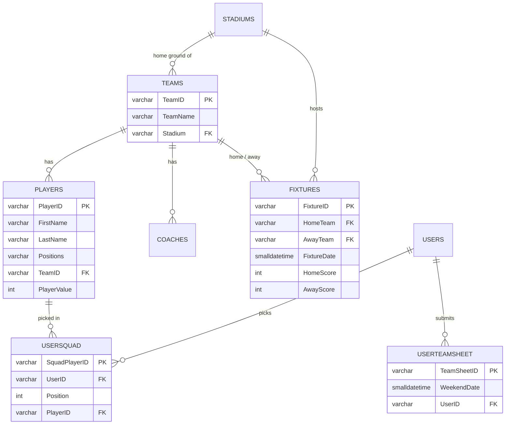

# DreamTeam API

The back end for a fantasy rugby game built around the **United Rugby Championship (URC)**. Players build a squad from real URC players, then pick a starting team each weekend.

The database was built from scratch: every team, stadium, coach and player was researched and entered by hand.

| | |
|---|---|
| Teams | 16 (every URC club) |
| Players | 759 |
| Stadiums | 24 |
| Coaches | 16 |

## Built with

- **C#** and **ASP.NET Core Web API** on **.NET 8**
- **Entity Framework Core** with **SQL Server**
- **Swagger / OpenAPI** for interactive API docs

## Data model



Every player has a unique ID (`PL0001` and so on) and a team ID, so two players with the same name, even at the same club, are never confused.

## Endpoints

Each resource has the full set of create, read, update and delete endpoints:

| Resource | Route |
|---|---|
| Players | `/api/players` |
| Teams | `/api/teams` |
| Coaches | `/api/coaches` |
| Stadiums | `/api/stadia` |
| Fixtures | `/api/fixtures` |
| Users | `/api/users` |
| User squads | `/api/usersquads` |
| Weekend team sheets | `/api/userteamsheets` |

For example, `GET /api/players/PL0001` returns:

```json
{ "playerId": "PL0001", "firstName": "Dian", "lastName": "Bleuler", "positions": "Prop", "teamId": "URC009" }
```

## Running it locally

You need the [.NET 8 SDK](https://dotnet.microsoft.com/download/dotnet/8.0) and SQL Server (LocalDB or Express is fine).

1. Create a database called `dream team` and run [`CreateTablePlayersAndTeams.sql`](CreateTablePlayersAndTeams.sql) against it. This creates the tables and loads all the data.
2. Check the connection string in `DreamTeamAPI/appsettings.json` points at your SQL Server.
3. Run the API:
   ```bash
   dotnet run --project DreamTeamAPI
   ```
4. Open `http://localhost:5135/swagger` to try every endpoint in the browser.
